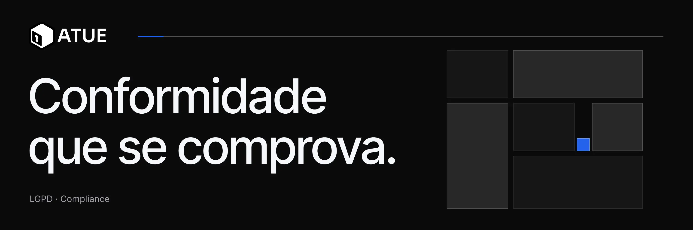
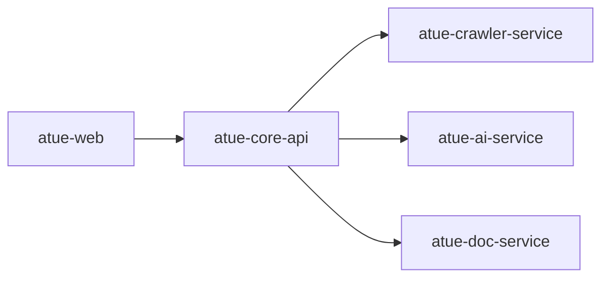

**Conformidade digital para empresas que precisam demonstrar confiança.**

LGPD · Segurança da informação · Governança digital

Pequenas e médias empresas enfrentam uma exigência crescente: demonstrar que tratam dados com responsabilidade e adotam boas práticas de segurança da informação. Isso pode ser um obstáculo para fechar contratos, atender exigências de clientes e participar de auditorias.

O problema nem sempre é a ausência de iniciativas, mas a dificuldade de identificar riscos, organizar evidências e transformar requisitos técnicos em ações concretas.

O ATUE nasce para simplificar esse processo.

Uma plataforma SaaS B2B concebida para ajudar empresas a compreender sua exposição digital, organizar suas ações de conformidade e demonstrar sua maturidade para clientes, parceiros e auditorias.

## Como funciona

O ATUE estrutura sua proposta em três etapas:

**01 — Avaliar**

Analisar a superfície pública do site e identificar possíveis riscos relacionados à LGPD e à segurança da informação.

**02 — Organizar**

Centralizar políticas, evidências e pendências, transformando observações em prioridades e ações acompanháveis.

**03 — Comprovar**

Consolidar informações e evidências em materiais que facilitem a comunicação da maturidade digital da empresa.

## Arquitetura

A solução é organizada em serviços especializados, com responsabilidades delimitadas e comunicação centralizada pelo core:

Cada componente possui uma função específica:

- **atue-web** — interface da plataforma, desenvolvida para tornar processos de conformidade acessíveis a usuários não técnicos.
- **atue-core-api** — núcleo de orquestração, autenticação, gerenciamento de organizações e persistência de dados.
- **atue-crawler-service** — inspeção stateless da superfície pública de sites.
- **atue-ai-service** — processamento e síntese das informações. A classificação de riscos utiliza regras determinísticas e catálogo fechado; o LLM local é utilizado exclusivamente para gerar resumos executivos.
- **atue-doc-service** — geração de documentos PDF a partir de templates e disponibilização dos arquivos por URLs presignadas.

Uma decisão central da arquitetura é manter a geração de texto por IA separada da classificação de riscos. O modelo não determina riscos, não seleciona artigos da LGPD e não inventa recomendações.

## Tecnologias

| Camada | Tecnologias |
| --- | --- |
| Frontend | React 19, TypeScript, Tailwind CSS |
| Core API | ASP.NET Core, .NET 10, SQL Server |
| Crawler | Go |
| Inteligência artificial | Python, FastAPI, LLM local |
| Infraestrutura | Docker, armazenamento compatível com S3 |

## Repositórios

| Repositório | Descrição |
| --- | --- |
| [atue-web](https://github.com/ATUE-PROA/atue-web) | Aplicação frontend da plataforma. |
| [atue-apresentation](https://github.com/ATUE-PROA/atue-apresentation) | Demonstração do fluxo de análise de conformidade. |

Os serviços de backend permanecem em repositórios privados durante o desenvolvimento do MVP.

## Status do projeto

EM DESENVOLVIMENTO · MVP · DEMODAY

O projeto está em fase de desenvolvimento e preparação para o Demoday. A demonstração atual utiliza dados simulados e não realiza operações reais de cadastro, armazenamento de arquivos ou cobrança.

O objetivo desta etapa é apresentar a proposta de valor, a experiência do produto e as decisões de arquitetura que fundamentam sua evolução.

**ATUE**

Entender. Organizar. Comprovar.

